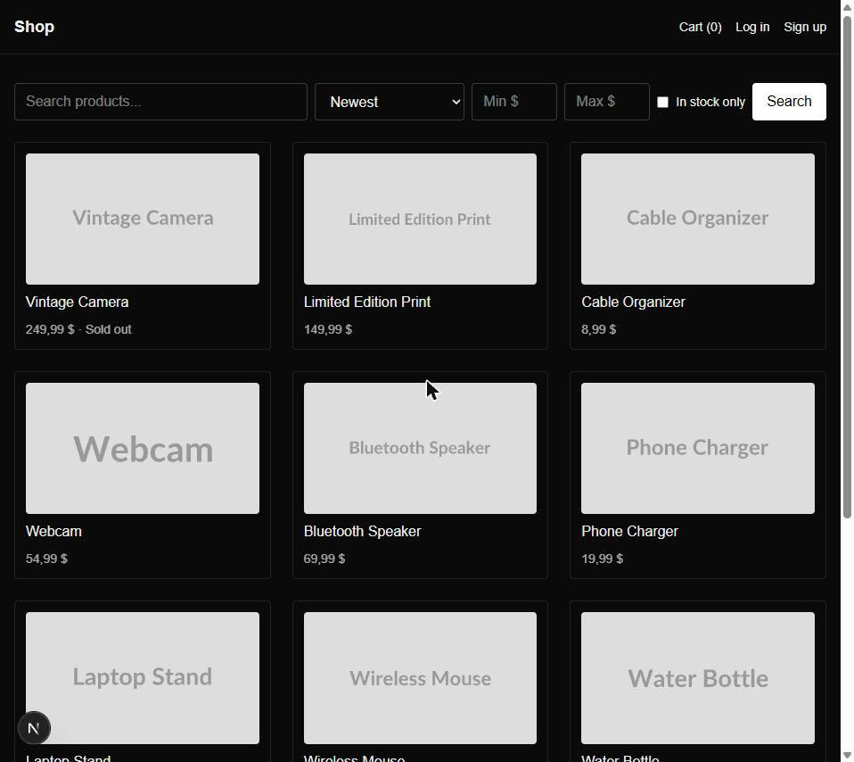
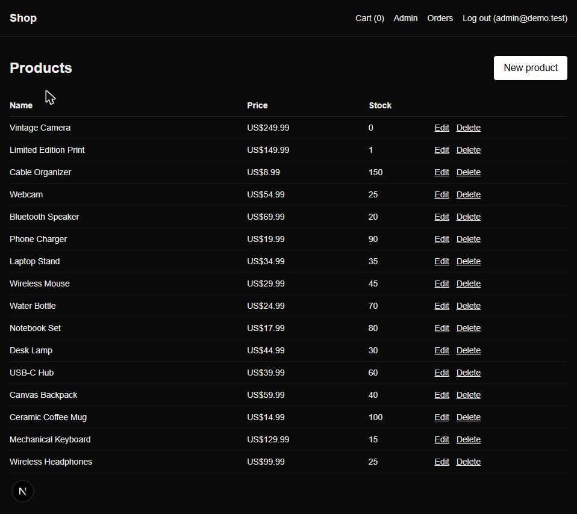
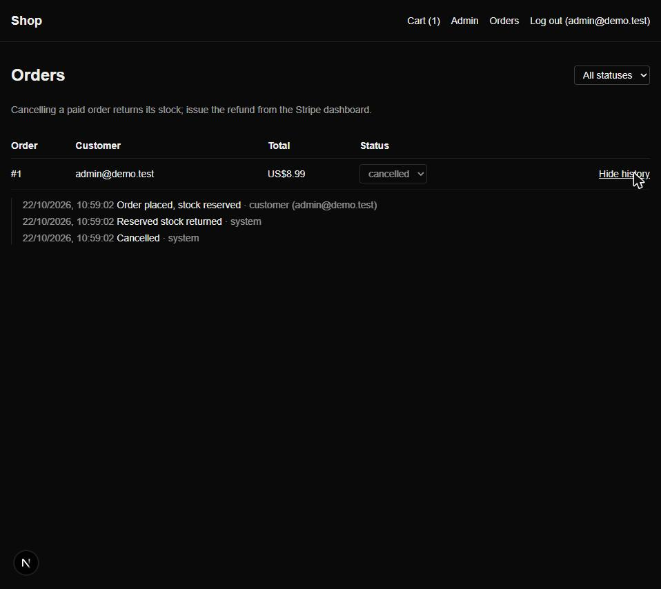
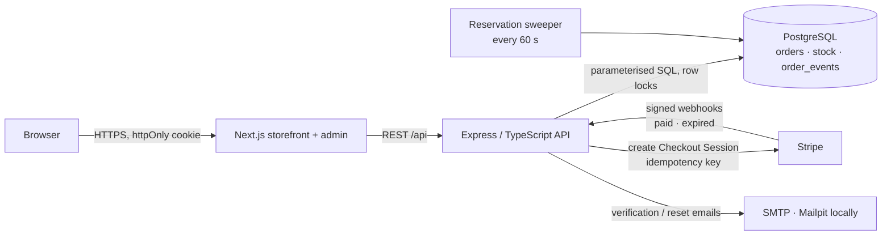

# E-commerce app

[](https://github.com/kgiannopoulou/fullstack-ecommerce/actions/workflows/ci.yml)

Next.js storefront and admin panel, Express/TypeScript API, PostgreSQL and Stripe Checkout. The interesting part is the order pipeline: **stock can't be oversold, a payment can't be processed twice, and abandoned or late payments clean up after themselves.** An automated test suite proves each of these against a real Postgres, with requests running concurrently.



| Admin: products and stock | Admin: an order's audit trail |
|---|---|
|  |  |

*Right: Stripe was unreachable at checkout, so the order was cancelled and its reserved stock returned
immediately — every step recorded in `order_events` with who caused it.*

## Architecture



The API owns every state change. Stock is reserved inside the same PostgreSQL transaction that
creates the order; Stripe only ever *confirms* a payment through a signed webhook, which is
de-duplicated by event id and applied idempotently. The sweeper is the safety net for anything
Stripe or a crashed request never told us about.

## What the tests prove

`backend/test/` holds 62 tests that run against a real database through the real HTTP stack, with a fake Stripe that uses Stripe's own webhook signing:

| Guarantee | Test |
|---|---|
| 12 buyers race for the last unit: exactly one wins, 11 get `OUT_OF_STOCK`, stock ends at 0, Stripe is called once | `checkout-races.test.ts` |
| Concurrent buyers wanting different quantities never oversell | `checkout-races.test.ts` |
| Carts locking the same products in opposite order don't deadlock | `checkout-races.test.ts` |
| A failed Stripe call cancels the order and returns its stock | `checkout-races.test.ts` |
| A replayed webhook (same event id) is acknowledged but not re-processed | `webhooks.test.ts` |
| 8 concurrent deliveries of one event, or the same payment as different events, mark the order paid once | `webhooks.test.ts` |
| An expired-session webhook returns stock exactly once, however often it's replayed, and can't cancel a paid order | `webhooks.test.ts` |
| A late payment re-reserves stock, or refunds **once** (idempotency key) if the stock is gone | `webhooks.test.ts` |
| If the refund call fails, the webhook returns 500, nothing changes, and Stripe's retry is processed | `webhooks.test.ts` |
| The reservation sweeper expires sessions, catches missed payments and is safe to run in parallel | `order-lifecycle.test.ts` |
| Admin moves are restricted, and an admin cancel racing the payment webhook never moves stock twice | `order-lifecycle.test.ts` |
| Single-use, hashed, expiring tokens for email verification and password reset, which also revokes old sessions | `auth.test.ts` |
| Rate limits on auth and checkout; validation errors with field paths; SQL-injection-safe search | `auth.test.ts`, `api.test.ts` |

Some of these were checked by breaking the guard on purpose: removing `AND stock >= $1` or the `paid_at` check makes the race and replay tests fail.

## Features

- **Atomic stock reservation** at checkout, released on expiry, cancellation or Stripe failure
- **Stripe Checkout + webhooks** with signature verification, event de-duplication and idempotent handlers
- **Order audit trail**: every status change and stock movement is recorded with who caused it (customer, Stripe, sweeper, admin), written in the same transaction as the change
- **Accounts**: email verification (required to order), password reset, sessions revoked on reset, role changes applied immediately
- **Rate limiting** on signup/login/reset and on checkout sessions per user
- **Consistent API errors**: `{ error: { code, message, details?, requestId } }` and Zod validation on every body, query and path parameter
- **Catalog** search, price/stock filters, sorting and pagination
- **Admin panel** for products and orders, with filters, pagination and each order's history
- **CI** on every push: type check, tests against Postgres, build, lint and Docker image

Full endpoint reference: [docs/API.md](docs/API.md).

## Quick start

Prerequisites: Node.js 20+, Docker, and a [Stripe](https://dashboard.stripe.com/register) account in test mode (plus the [Stripe CLI](https://docs.stripe.com/stripe-cli) for local webhooks).

```sh
# 1. Postgres (dev + test) and Mailpit for emails
docker compose up -d

# 2. Backend
cd backend
cp .env.example .env      # fill in STRIPE_SECRET_KEY, STRIPE_WEBHOOK_SECRET, JWT_SECRET
npm install
npm run migrate
npm run db:seed            # sample catalog + demo accounts
npm run dev                # http://localhost:4000

# 3. Frontend (separate terminal)
cd frontend
cp .env.local.example .env.local
npm install
npm run dev                # http://localhost:3000

# 4. Stripe webhooks (separate terminal)
stripe listen --forward-to localhost:4000/api/webhooks/stripe
# copy the whsec_... it prints into backend/.env as STRIPE_WEBHOOK_SECRET
```

Verification and password-reset emails land in Mailpit at http://localhost:8026.

### Demo accounts

`npm run db:seed` creates two pre-verified accounts:

| Account | Password | |
|---|---|---|
| `admin@demo.test` | `demo-admin-pass` | Admin panel at `/admin` |
| `customer@demo.test` | `demo-customer-pass` | Can check out straight away |

Pay with `4242 4242 4242 4242`, any future expiry and any CVC. "Limited Edition Print" has one unit in stock, so you can try the last-unit race by hand from two browsers.

### Tests

```sh
cd backend
npm test        # needs the postgres-test container from docker compose (port 5437)
```

The test database is rebuilt from the real migrations on every run. Set `TEST_DATABASE_URL` to use a different one.

## Orders, stock and payments

All order/stock transitions live in `backend/src/features/checkout/orderLifecycle.ts`:

- **Stock is reserved at checkout**, not when payment arrives. Creating the checkout session decrements stock atomically (`... WHERE stock >= qty`) in the same transaction as the order, so two customers can't both pay for the last unit. The second gets a "not enough stock" error before reaching Stripe. Rows are locked in product-id order, so overlapping carts can't deadlock.
- **Quantities are merged per product** before validation, so the same product on several cart lines can't exceed stock.
- **Unpaid reservations are released**: Stripe sessions expire after 30 minutes. The `checkout.session.expired` webhook and a once-a-minute sweeper cancel the pending order and return its stock. The sweeper also cleans up orders whose Stripe session was never created, and marks orders paid if the payment webhook was missed.
- **Stripe failures don't leave orphans**: if creating the session fails, the order is cancelled and its stock returned immediately (502 to the client).
- **Idempotent stock movements**: each order has a `stock_reserved` flag that every reserve/release checks and flips in the same transaction, and `paid_at` marks a payment as processed. Webhook retries/replays, admin edits and the sweeper can't move stock twice. On top of that, processed Stripe event ids are stored and duplicates are acknowledged without being processed.
- **Restricted admin status changes**: `pending → cancelled`, `paid → shipped | cancelled`. Orders never go back to `pending`, and `paid` is only set by a confirmed Stripe payment. Cancelling returns stock (refund paid orders from the Stripe dashboard).
- If a payment arrives after its reservation was released and the stock is gone, the customer is **refunded automatically** and the order cancelled.
- **Every change is audited** in `order_events`, written in the same transaction, so the history can't disagree with the order. Customers see their order's timeline; admins also see who did each step.

## Accounts and sessions

- The session JWT (httpOnly, `SameSite=Lax` cookie) carries only the user id and a `session_version`. Role and verification status are loaded from the database on every request, so promoting a user to admin takes effect immediately and a password reset logs out every other session.
- Verification and reset links use random 256-bit tokens. Only their SHA-256 hash is stored, they are single-use (atomic `UPDATE … WHERE used_at IS NULL`) and they expire (24 h / 30 min).
- "Forgot password" answers identically whether or not the account exists, and login gives the same error for an unknown email and a wrong password.

To make yourself an admin without the seed, sign up and run:

```sql
UPDATE users SET role = 'admin' WHERE email = 'you@example.com';
```

## Deploying a demo

`render.yaml` deploys Postgres, the API (Docker) and the storefront to Render's free tier, with Stripe in test mode. See [docs/DEPLOY.md](docs/DEPLOY.md) for the steps.

## Design decisions

**Why reserve stock at checkout instead of at payment?** Reserving after payment means two people
can pay for the last unit and one must be refunded. Reserving first (`UPDATE … WHERE stock >= qty`
in the order's transaction) turns overselling into a clean `OUT_OF_STOCK` before anyone reaches
Stripe; the cost is releasing abandoned reservations, which the expiry webhook and the sweeper do.

**Why raw SQL with `pg` instead of an ORM?** The correctness lives in the SQL: conditional updates,
row locks taken in product-id order, flags flipped in the same statement that moves stock. Writing
it by hand keeps those guarantees visible and reviewable, and the migrations are plain `.sql` files.

**Why trust webhooks, not the redirect?** The browser's return from Stripe can be faked, lost or
arrive twice. Orders become `paid` only from a signature-verified `checkout.session.completed`
event, stored by event id so replays are acknowledged but not re-processed.

**Why a sweeper as well as webhooks?** Webhooks can be missed (downtime, misconfiguration). A
once-a-minute sweeper reconciles with Stripe — expiring stale reservations and catching missed
payments — and is written to be safe when several instances run it at the same time.

**Why load role and verification from the database on every request?** The JWT carries only the
user id and a `session_version`. Promotions, demotions and "log out everywhere" after a password
reset take effect immediately, at the cost of one indexed lookup per request.

**Why test against a real PostgreSQL?** Races, deadlocks and idempotency are database behaviour; a
mocked repository would pass every one of these tests while the real system oversold.

## Production considerations

Built and tested toward production, deployable as a demo on Render's free tier, but not running a
real shop. Before taking real payments:

* **Secrets** — Stripe live keys, webhook secret and `JWT_SECRET` in the platform's secret store,
  rotated, never in `.env` files on servers.
* **Payments compliance** — Stripe Checkout keeps card data off our servers (PCI SAQ A); add
  Stripe Tax, receipts, refunds from the admin panel and a terms/privacy flow.
* **Scaling** — the API is stateless and can run several instances; the in-process sweeper should
  move to a single scheduled job (or keep running everywhere — it is concurrency-safe — but that
  wastes queries). Add PgBouncer and a read replica for the catalog.
* **Data protection** — daily backups with point-in-time recovery, GDPR export/deletion for
  accounts, retention for `order_events`.
* **Security hardening** — `helmet` security headers and a CSP on the frontend, CSRF tokens if the
  cookie ever moves to `SameSite=None`, dependency and secret scanning in CI, and rate limits
  backed by Redis instead of process memory.
* **Observability** — structured JSON logs carrying the existing `requestId`, metrics on checkout
  conversions, webhook failures and sweeper corrections, and alerts on webhook 5xx.
* **Email** — a real provider (SES / Postmark) with SPF/DKIM instead of Mailpit.

## Limitations

* **Stripe test mode only**; no tax, shipping rates, coupons or partial refunds.
* **In-memory rate limits** — reset on restart and not shared between instances.
* **Images are URLs** — no upload pipeline or CDN.
* **No end-to-end browser tests yet** — the 62 tests cover the API through HTTP; the frontend is
  type-checked, linted and built in CI.

## Project layout

- `backend/`: Express API with raw `pg` and hand-written SQL migrations (`backend/src/db/migrations`). `src/app.ts` builds the app (used by the tests), and `src/index.ts` starts it.
- `backend/test/`: Vitest + supertest suite against Postgres
- `frontend/`: Next.js App Router storefront and admin panel
- `docs/`: API reference and deployment guide
- `docker-compose.yml`: local Postgres, test Postgres and Mailpit

## Contributing and license

[CONTRIBUTING.md](CONTRIBUTING.md) · [Changelog](CHANGELOG.md) · [MIT](LICENSE) © 2026 kgiannopoulou
